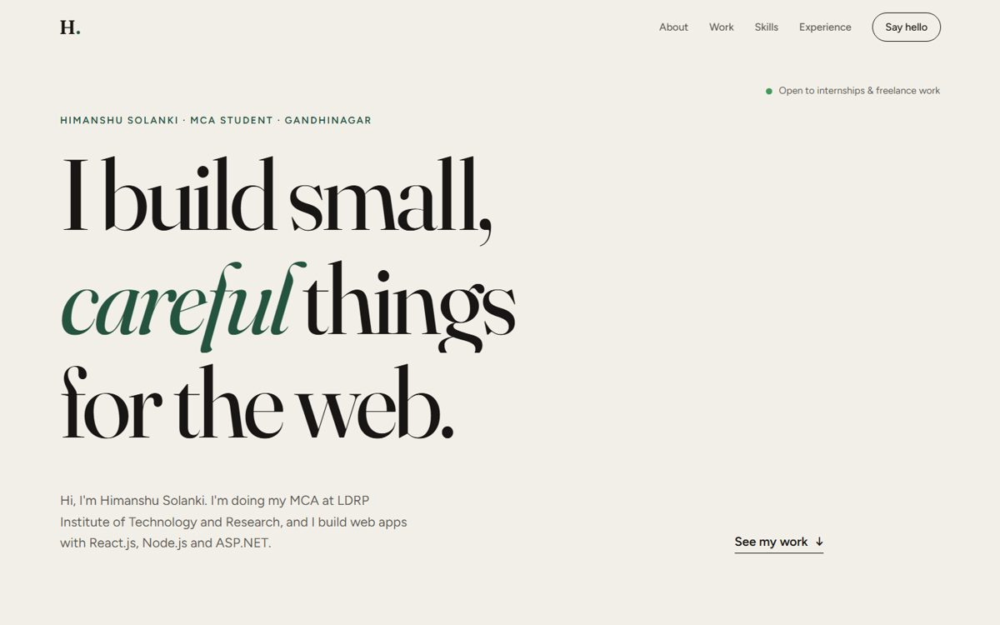

# Portfolio

Task 3 of the CodeAlpha Frontend Development internship.

Portfolio of **Himanshu Solanki**, an MCA student at LDRP Institute of Technology and Research, Gandhinagar. It's built with HTML, CSS and a little vanilla JavaScript. It has sections for About, Work (CodeAlpha projects plus earlier projects), Skills, Experience & Education (with a résumé download) and Contact. I went for an editorial look: an off-white background, a big serif headline and one dark green accent.



## Features

- **Hero headline** that slides up line by line once the fonts have loaded, so the text doesn't jump
- **Smooth scrolling** between sections. The nav underlines whichever section you're reading.
- **Reading progress bar** along the top of the page
- **Navigation:** the nav bar hides when you scroll down and comes back when you scroll up
- **Mobile menu:** a full-screen menu that opens with a circular reveal
- **Scroll animations:** content fades in as it scrolls into view, with a small delay between items in the same group
- **Count-up numbers** in the About section
- **Project cards** with screenshots that zoom slightly on hover and an arrow that slides in
- **Skills marquee:** a scrolling strip of skills that pauses on hover
- **Contact form:** checks every field and the email format, shows errors inline and uses floating labels. There's no backend, so on submit it opens the visitor's email app with the message already filled in.
- **Accessibility:** respects `prefers-reduced-motion`
- **Responsive** down to small phones

## Running it

Open `index.html`, or run `npx serve .` in this folder.

> The project cards link to `../CodeAlpha_ImageGallery/index.html` and the other project folders, so they work when all four projects sit next to each other locally. After deploying, swap these for the live links.

## Updating it

| What | Where |
| --- | --- |
| Intro, about text | `index.html` (hero and about sections) |
| Email used by the contact form | `MY_EMAIL` at the top of `script.js` |
| GitHub / LinkedIn links | the `contact__links` list in `index.html` (still placeholders) |
| Résumé | `assets/Himanshu_Solanki_Resume.pdf` |
| Project links | the four `project__link` hrefs |
| Colours | CSS variables at the top of `style.css` |

## Deploying (bonus)

**GitHub Pages**

1. Push this folder to a repo called `CodeAlpha_Portfolio`.
2. Go to *Settings → Pages → Build and deployment* and choose **Deploy from a branch**, branch `main`, folder `/root`.
3. After a minute the site is live at `https://<your-username>.github.io/CodeAlpha_Portfolio/`.

**Netlify**

Drag the folder onto [app.netlify.com/drop](https://app.netlify.com/drop). That's it.

## Folder structure

```
CodeAlpha_Portfolio/
├── index.html
├── style.css
├── script.js
├── assets/
│   ├── shot-gallery.jpg
│   ├── shot-calculator.jpg
│   ├── shot-player.jpg
│   └── Himanshu_Solanki_Resume.pdf
└── README.md
```

## How a few things work

- **Scroll handling:** all the scroll work (progress bar, nav state) is batched into one `requestAnimationFrame` per frame, so scrolling stays smooth.
- **IntersectionObserver** does three jobs: revealing elements, starting the count-up, and finding the current section. The current-section observer uses `rootMargin: "-45% 0px -50% 0px"`, so a section counts as current when it crosses the middle of the screen.
- **Floating labels** are pure CSS. They use `:placeholder-shown` with an empty placeholder (`placeholder=" "`).

## Fonts

Fraunces (headings) and Figtree (body), from Google Fonts.
